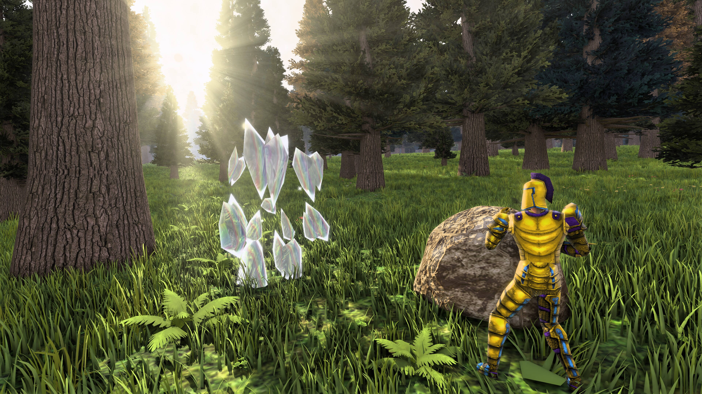
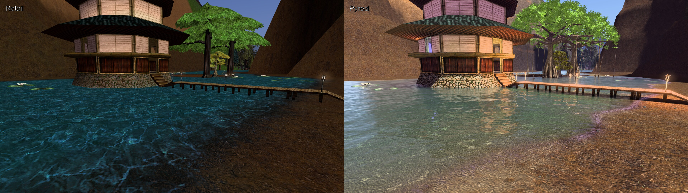
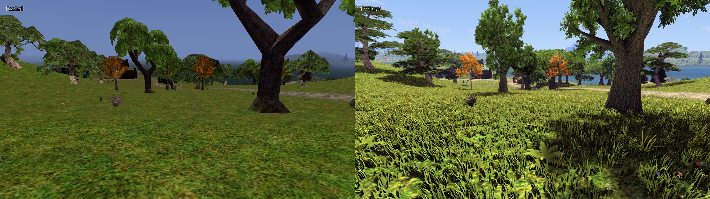
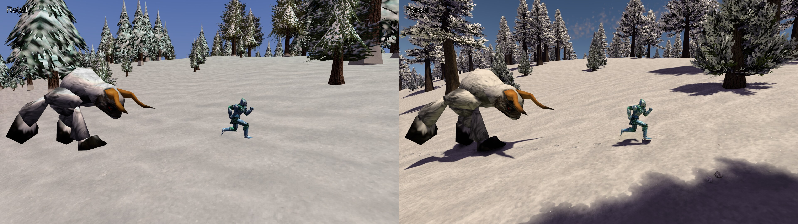
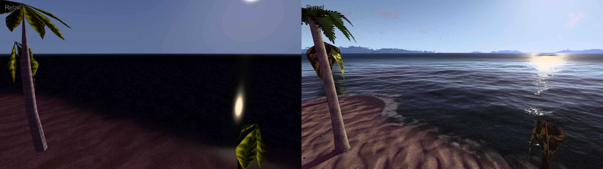
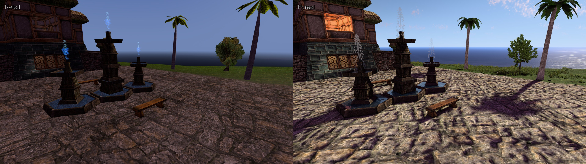
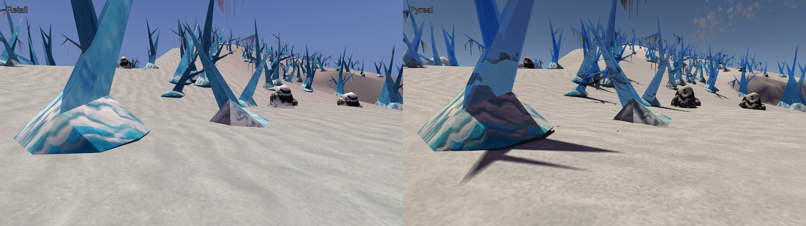
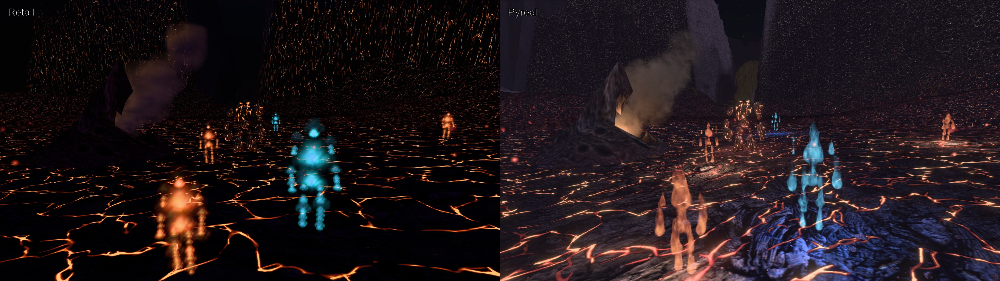
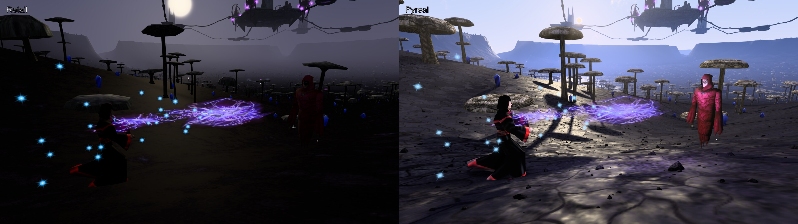
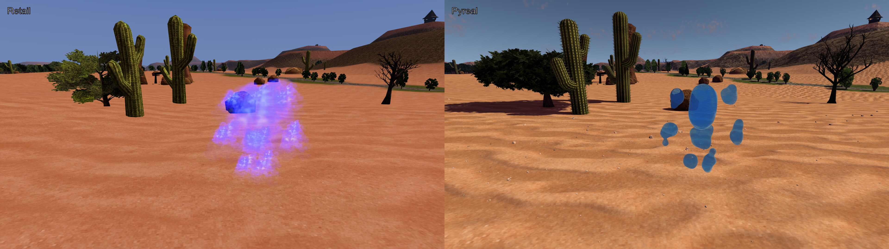

# Pyreal

<!-- shot: forest-god-rays -->


Welcome! Pyreal is my custom, experimental fork of
[Dereth](https://github.com/dereth-network/dereth). I fell in love with Asheron's Call decades
ago, and over the years my memory of it has grown into something a little grander than the game
ever was. Pyreal is where I try to draw Dereth the way I remember it: the light, the weather, the
water and the creatures as they looked in my mind.

It's a labour of love and very much a personal project, so it moves quickly and follows my own
taste. Some of what you'll find here is still an experiment. When a feature proves itself and fits
the vision of Dereth's creators, I bring it over to Dereth so everyone can enjoy it.

In the before-and-after pictures below, the retail look is on the left and Pyreal is on the right.

## Built on Dereth

Pyreal wouldn't exist without [Dereth](https://github.com/dereth-network/dereth), and nearly
everything underneath it is Dereth's work. Dereth is an open-source reimplementation of Asheron's
Call by kazin and the Dereth Network contributors. It's a client that behaves just like the final
retail client, with every behaviour carefully written down, tested and backed by evidence, and it
comes with its own server, world builder and the Dereth Network. The data file readers, the wire
protocol, the game rules, the physics, the animation, the Horizon interface, the plugin host and the
client runtime all come from Dereth, and I'm grateful for every bit of it. Pyreal keeps Dereth's
MIT license, inherited along with the code.

If you're looking for a modern Asheron's Call client to play, I'd warmly recommend starting with
[Dereth](https://github.com/dereth-network/dereth). It has proper releases, a launcher, and the
thoughtful, careful work that makes it all possible. Think of Pyreal as my sketchbook beside it.

Pyreal also owes a lot to:

- **Empyrean**, Dereth's server, ported from ACE. Pyreal plays on Empyrean worlds and reads the
  extra game data they serve.
- **[ACE](https://github.com/ACEmulator/ACE)**, the Asheron's Call Emulator. Pyreal's physics and
  network fixes are checked against ACE's behaviour, and it plays happily on ACE worlds.
- **The Enhanced Environment**, the art pack built into Pyreal, from my
  [dereth-enhanced-environment](https://github.com/jacobjohnston/dereth-enhanced-environment)
  repository.

<!-- shot: wai-jhou -->


## What Pyreal adds

Most of all, Pyreal is about the graphics. It draws Dereth with a new renderer made for today's
graphics cards, and everything below comes from it.

- **Light.** Light that adjusts to bright and dark the way your eyes do, soft glows around lamps
  and flames, sun shadows stretching across the whole view, and lamplight that falls just where it
  should. Corners and crevices are gently shaded, and light bounces off walls and the ground. Every
  torch, sconce, candle and brazier burns with a real flickering flame.

<!-- shot: forest -->


- **Sky and weather.** A sky that changes through the day, clouds with depth that cast shadows and
  follow the weather, sunbeams through the trees, fog, and thunderstorms with lightning. Snow falls
  on snowy lands and settles on the ground and rooftops, you leave footprints as you walk, and rain
  stays off anything under a roof.

<!-- shot: north-mountains-footprints -->


- **Water.** Waves that rise and fall, a sea swell that rolls in and breaks into surf, water lapping
  up every beach, calm lakes and rivers, and froth and a wake around anything wading through.

<!-- shot: stoneport-shore -->


<!-- shot: manor-fountains -->


- **The land.** Softer, smoother hills, roads and walls with real depth, grass and wildflowers that
  ripple in passing breezes, trees that lean and sway, and a view that stretches all the way to the
  horizon.

<!-- shot: fiun-outpost -->


- **Creatures.** Smoke, dust, steam, frost and acid creatures swirl as living clouds, fire creatures
  burn as living flame, golems look like what they're made of, and storm creatures crackle with
  forked lightning.

<!-- shot: caulcano-creatures -->


<!-- shot: obsidian-plains-battle -->


<!-- shot: yaraq-creatures -->


- **Places.** Fine silk cobwebs in the dungeons, glowing lava, glacier ice, moons as round worlds
  with their phases, and portal space as a tunnel you fly through in the original's slate blue and
  violet.
- **Eras.** Worlds from the October 1999 launch, February 2005 and the End of Retail each keep the
  feel of their own time, with every enhancement on top.
- **Sound.** An Enhanced sound style that plays many more sounds at once, places them all around
  you, echoes indoors and loops the background smoothly.
- **Your choice of look.** Quality presets from Low to Ultra and a setting for each effect, so it
  runs nicely on a laptop and looks its best on a desktop. You can add other art packs and switch
  between them whenever you like.

You'll find every change in each release in [CHANGELOG.md](CHANGELOG.md).

## Your game files

Pyreal plays using the game's data files from your own copy of Asheron's Call, so they're never
included here or in any download. It works with three versions of the game:

- **The October 1999 launch**, from the original CD.
- **February 2005**, the Infiltration era, just before Throne of Destiny.
- **The End of Retail**, the final client from when the official servers closed.

These three are the ones Pyreal is built around. The first time it starts, it'll ask you for the
folder that holds them.

## Getting started

Each release on the [Releases](../../releases) page has a download for Mac, Windows and Linux.
Pick the one for your computer and follow its steps below.

### Mac

1. Download `Pyreal-<version>-macos-aarch64.dmg`. It's for Macs with Apple silicon.
2. Double-click the download to open it, then drag **Pyreal** onto the **Applications** folder
   beside it.
3. Eject the Pyreal disk in the Finder's sidebar, and open Pyreal from Applications or Launchpad.
   The first time, macOS checks that the app is from a known developer and asks whether to open
   it. Choose Open.

### Windows

1. Download `pyreal-<version>-windows-x86_64.zip`.
2. Right-click the zip, choose **Extract All**, and pick where you'd like Pyreal to live, such as
   your Documents folder.
3. Open the `pyreal-<version>` folder and double-click **Pyreal**. You can right-click it and
   choose **Pin to Start** to find it again easily.

Pyreal runs on Windows 10 and 11, with a graphics card that supports DirectX 12 or Vulkan.

### Linux

1. Download `pyreal-<version>-linux-x86_64.tar.gz`.
2. Unpack it where you'd like Pyreal to live:

   ```bash
   mkdir -p ~/.local/opt && tar -xzf pyreal-<version>-linux-x86_64.tar.gz -C ~/.local/opt
   ```

3. Run `pyreal` from the `pyreal-<version>` folder. The first time, Pyreal adds itself to your
   desktop's applications menu, so you can start it from there afterwards.

Pyreal runs on Ubuntu 22.04 or newer, and other distributions of the same age, with Vulkan graphics
drivers installed.

### Your first visit

When Pyreal opens, point it at your game files folder, then add a world to the world list. Any
server running Dereth's Empyrean or ACE will do. Sign in, pick a character, and enjoy.

If you'd like to build Pyreal yourself or tinker with it, [docs/BUILDING.md](docs/BUILDING.md) will
walk you through it.

### Updates

When Pyreal opens, it checks GitHub for a newer release, at most once a day, and the world list
tells you when one is out. The check is a plain request to this repository's latest release and
sends nothing about you or your computer. Turn off **Check for Updates** in Settings to stop it.

## License

Pyreal is under Dereth's MIT license, inherited from Dereth along with its code. You can read it in
[`LICENSE`](LICENSE).

Pyreal is an independent fan project and isn't affiliated with or endorsed by Microsoft, Turbine or
any current rights holder of Asheron's Call.

AI is used to help with development.
